# Open Immerse / 沉浸译

[中文](README.md) · **English**

An open-source Chrome extension: a paper PDF on the left, the translation on the right.

[](https://github.com/wisdom-km/open-immerse/releases)
[](LICENSE)
[](manifest.json)

Current version **0.3.0** (`main` @ `a8a6efd`). Requires Chrome 114 or newer. Not affiliated with the commercial product “Immersive Translate” (沉浸式翻译).

Repository: <https://github.com/wisdom-km/open-immerse>

The on-screen language is Simplified Chinese. Button names below are the labels in the UI, with an English gloss.

Screenshots live in [`docs/assets/readme/`](docs/assets/readme/). Until those files are in the tree, each section still stands on its own and the image slot shows its text alternative. API keys in the screenshots are placeholders.


After a PDF opens, the left pane is the original and the right pane fills in a translation paragraph by paragraph. This clip is from the v0.3.0 walkthrough of arXiv [1706.03762](https://arxiv.org/abs/1706.03762), “Attention Is All You Need”. It covers about the first 30 seconds and stops as the first page starts to translate. With the default setting, later pages continue. MP4 of the same clip: [`04-pdf-open-translate-hero.mp4`](docs/assets/readme/04-pdf-open-translate-hero.mp4).

## What it does

Open Immerse (沉浸译) opens a paper in its own reader: pdf.js shows the original page on the left, and the translation sits on the right. Requests go to the model you configure. The key stays on the machine.

A v0.3.0 install walkthrough passed the PDF path: install, engine setup, side-by-side reading, formulas, font size, figures, retranslate, notes, reopen, and the diagnostics export. Webpage bilingual translation does insert a gloss, and it currently has a color bug. See “Known limitations”.

Reading order in this version is the order extracted from the PDF text layer. The browser extension does not reorder the page into a new layout.

## PDF reading

PDF reading is on by default. Open the toolbar popup and click **打开 PDF** (Open PDF). A tab that is already a PDF opens in the reader. Any other page opens the reader library. The reader can also open a local PDF.

Opening a PDF starts a full-document translation. The switch is under **设置 → PDF 阅读** (Settings → PDF), labeled 「打开 PDF 时自动翻译全文」.

### Side by side

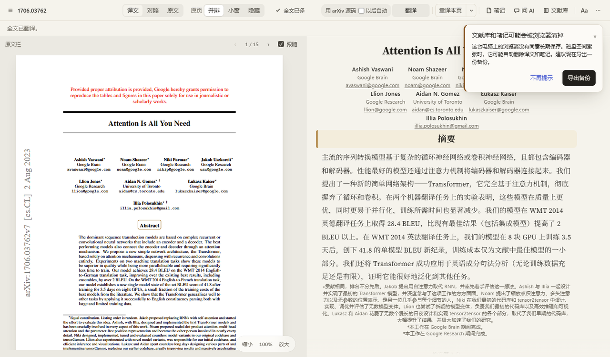

The left pane scrolls the original. The right pane lists the translation in reading order, and the translation stays in that pane. The walkthrough paper is 15 pages, and opening it started a full translation.

### Formulas

By default, display formulas and inline formulas are cropped from the original PDF and placed in the translation. Equation numbers stay. Crops are painted at an 18 px reference size and do not follow the font-size slider.

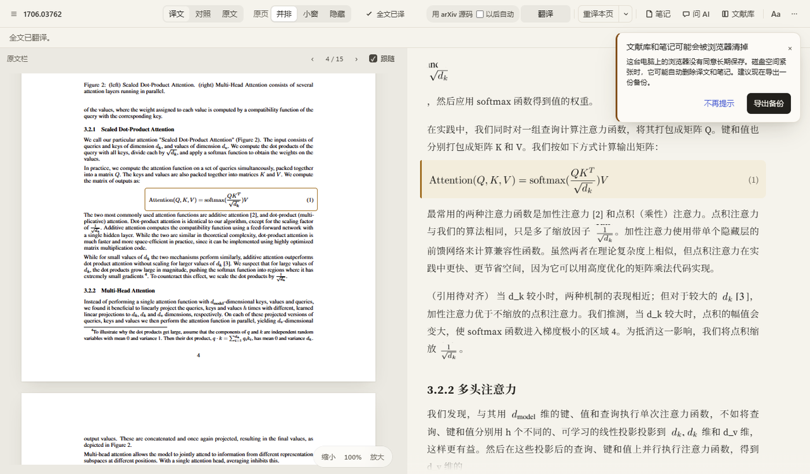

An arXiv paper can switch to source formulas. **用 arXiv 源码** (Use arXiv source) in the top bar replaces the crop with LaTeX from the paper source, rendered by the vendored KaTeX into selectable math. The control does not download source until it is clicked. In the walkthrough the status read 「公式 · arXiv 源码 v7」, and that paper rendered 111 KaTeX formulas.

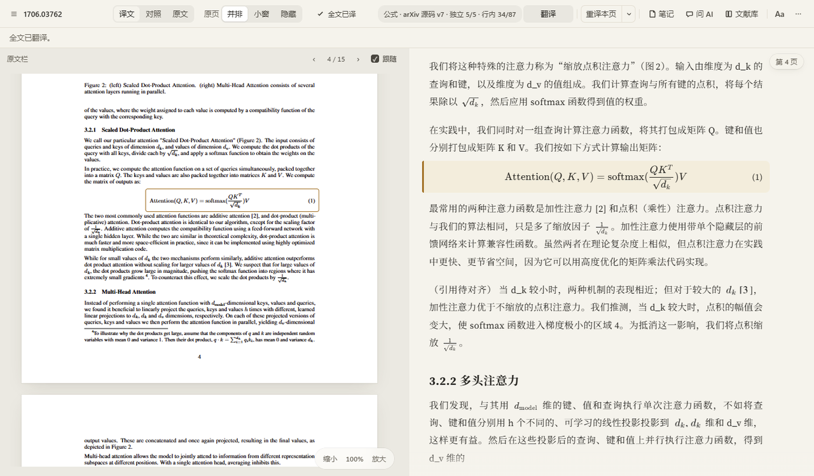

Source mode is not remembered on its own. Check **以后自动** (Automatically from now on) beside the control to keep it. Otherwise the next open starts from crops again.

### Font size

**Aa** in the top bar opens a font-size slider. The steps are 14, 15, 16, 17, 18, 19, 20, 22, 24, 26, 28, 32, 36, and 40 px. The default is 16. Dragging updates the right-pane translation immediately, and the slider can return to 16. When the column is too narrow for the minimum line length, the cap is below 40. KaTeX uses `1.1em` and follows the right-pane size. Original-page crops do not.

The walkthrough dragged the slider from 16 to 24 and then restored the default.

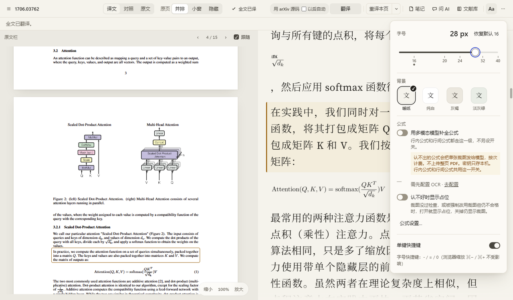

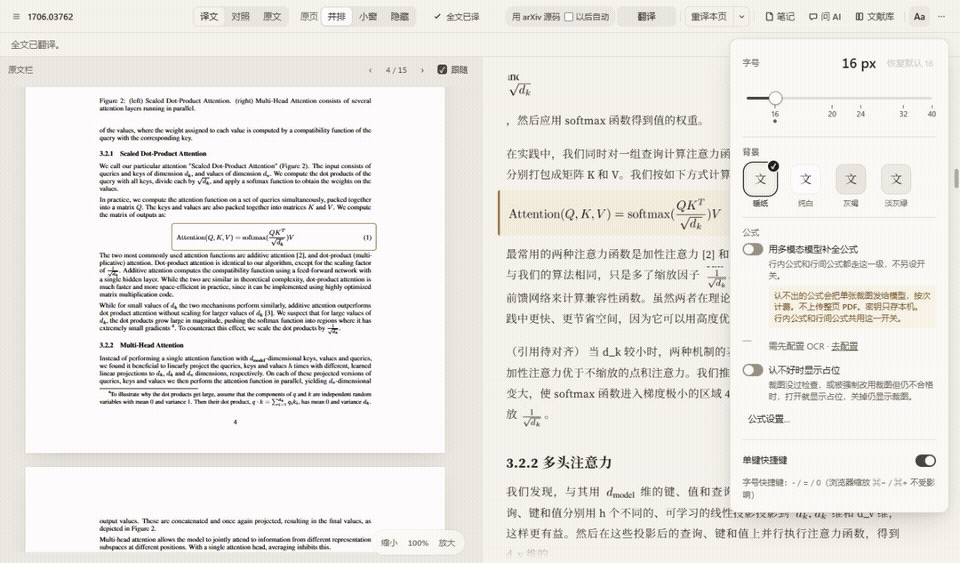

MP4 of the same action: [`04-pdf-font-slider.mp4`](docs/assets/readme/04-pdf-font-slider.mp4).

### Figures

Figures in the translation appear as cards. Opening a card shows a larger image and the original page number.

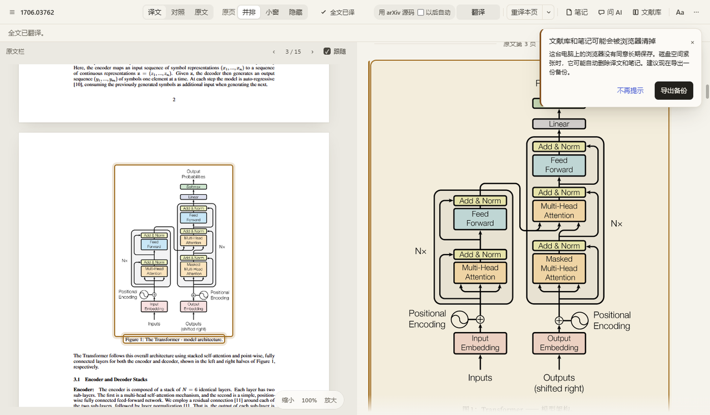

### Notes

Select a sentence in the translation and click **笔记** (Note) on the selection toolbar. The note is stored in the notes column on the right. Notes live in the extension’s IndexedDB database `oi-annotations`, separate from the extension folder.

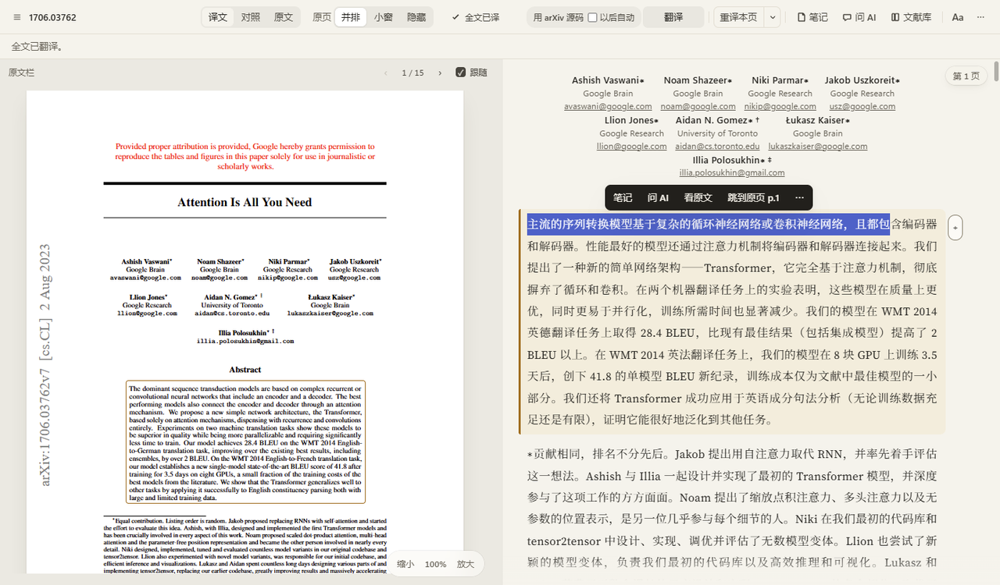

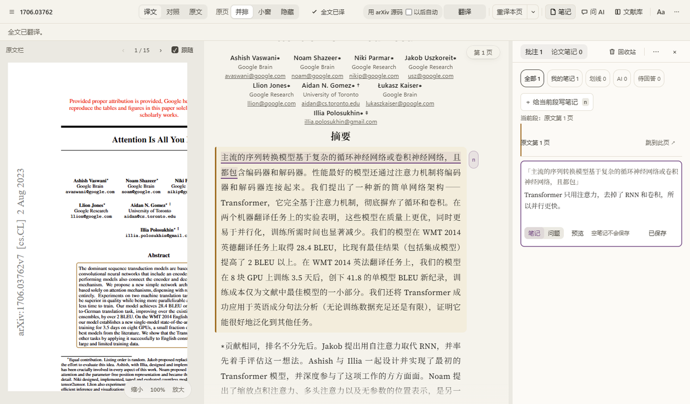

The **⋯** menu in the notes column includes **导出 Markdown** (Export Markdown). The walkthrough wrote `1706.03762-笔记.md`, with the quoted source and the note body. Sample file: [`05-notes-export-sample.md`](docs/assets/readme/05-notes-export-sample.md). When the document has no title, the Markdown heading is 「未命名论文」. See “Known limitations”.

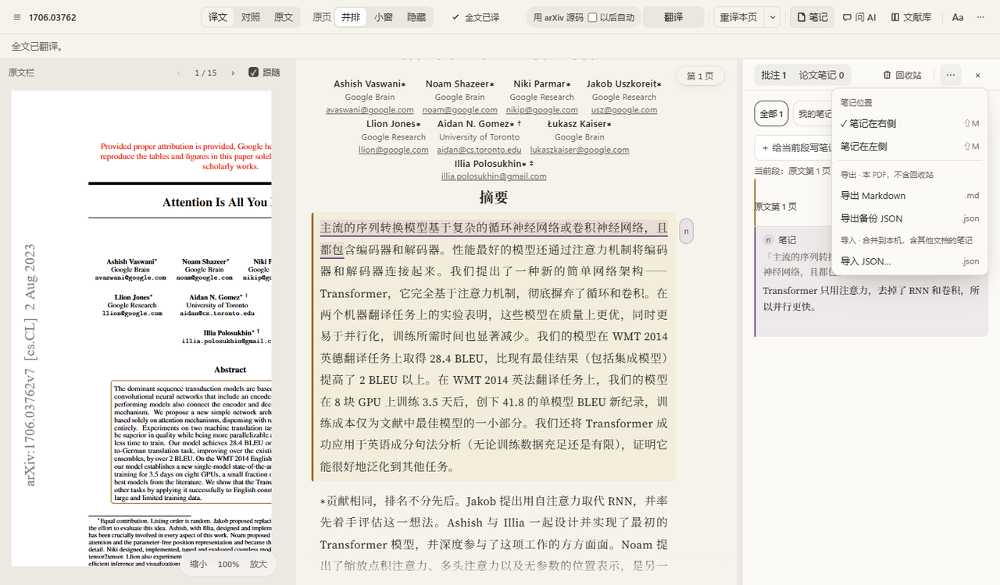

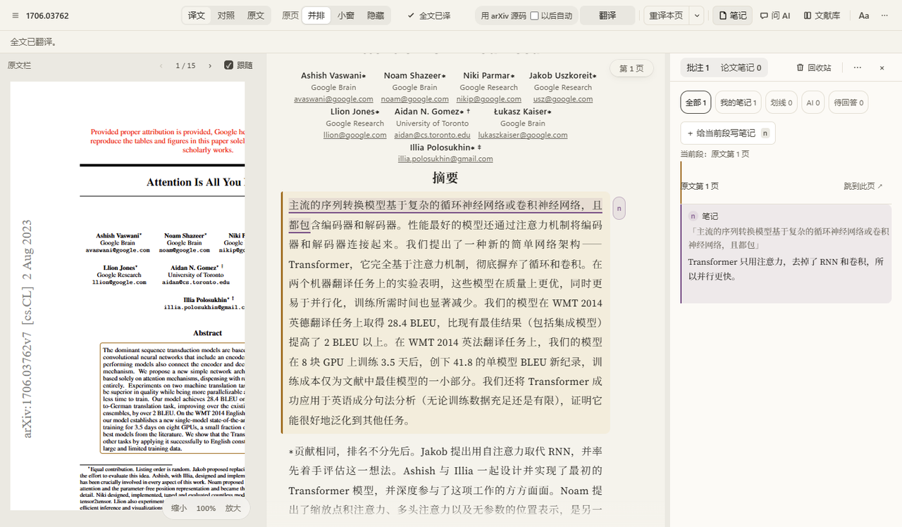

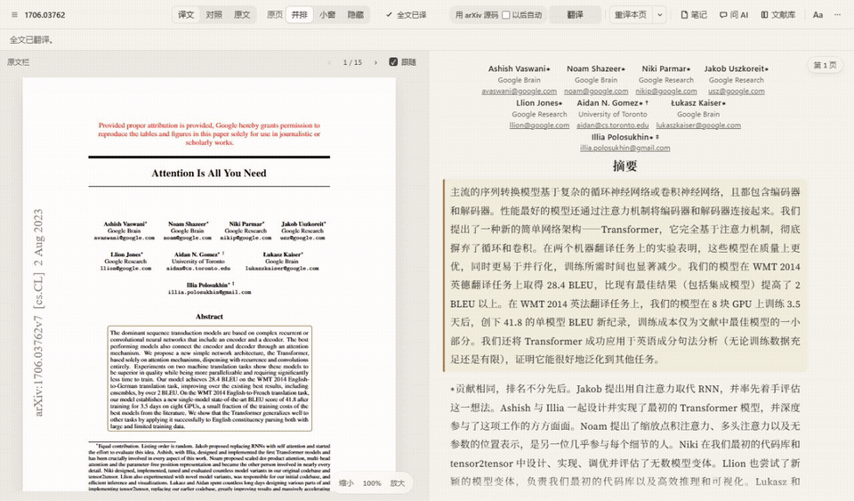

MP4 of the same action: [`05-notes-select-to-note-hero.mp4`](docs/assets/readme/05-notes-select-to-note-hero.mp4).

### Opening the same PDF again

Close the reader and open the same PDF again. The translation is read back from the local library. Restoring it does not send another translation request. Notes and highlights remain.

One reopen of this paper in the v0.3.0 walkthrough read 145 translated segments back in about 1.3 seconds, kept the one existing note, and sent no new translation request.

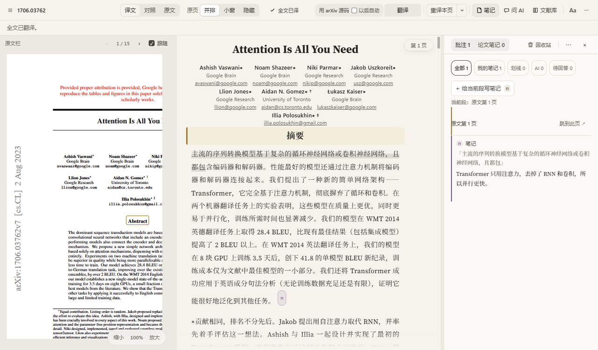


MP4 of the same action: [`06-reopen-restore.mp4`](docs/assets/readme/06-reopen-restore.mp4).

### Retranslate

The menu next to **重译本页** (Retranslate this page) has three items:

| Item | Effect |
| --- | --- |
| 重译本页 | Replace the current page |
| 重译全文 | Translate again from page 1 |
| 清空本文档译文… | Delete this document’s translation and formula cache. Notes stay. Translating again is required after a clear |

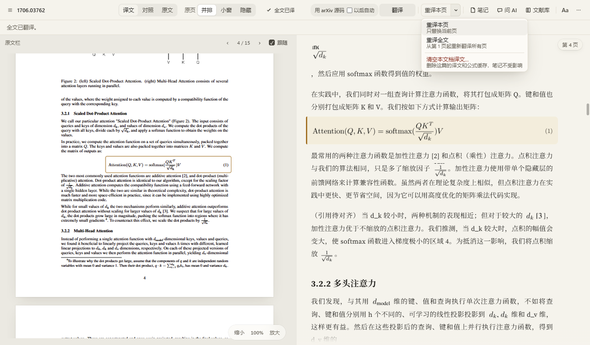

Retranslating one page or the whole document leaves notes in place.

## Webpage bilingual view

Webpage translation is a secondary feature. On a page, click **翻译此页** (Translate this page) in the popup. A translation appears under each original block that is included.

The default quota is **仅标题+开头** (`translateLimit: title_lead`): the heading, plus the first body paragraph. That paragraph is also capped at about 3 lines or 220 characters. See `lib/translate-limit.js`. Under Settings → 网页 (Web), change 「本次翻译」 to **全部** (All) to continue through the rest of the page. Batch size only decides how many segments go into one request.

The walkthrough switched the quota to All in order to capture a full page. A fresh install that shows a translation only on the title and the first paragraph is following this default.

Styles injected into every page currently force a dark color scheme on the host page. This README does not include a webpage screenshot while that remains. See “Known limitations”.

## Install

Download the v0.3.0 zip from [GitHub Releases](https://github.com/wisdom-km/open-immerse/releases), unzip it, and load the folder. Chrome 114+ is required (`minimum_chrome_version` is `114`). The v0.3.0 install walkthrough used a Chromium build with Manifest V3, loaded the same way.

1. Open `chrome://extensions`.
2. Turn on Developer mode.
3. Click Load unpacked and choose the unzipped folder that contains `manifest.json`.
4. After 「沉浸译 0.3.0」 is enabled, click the toolbar icon. The popup opens.

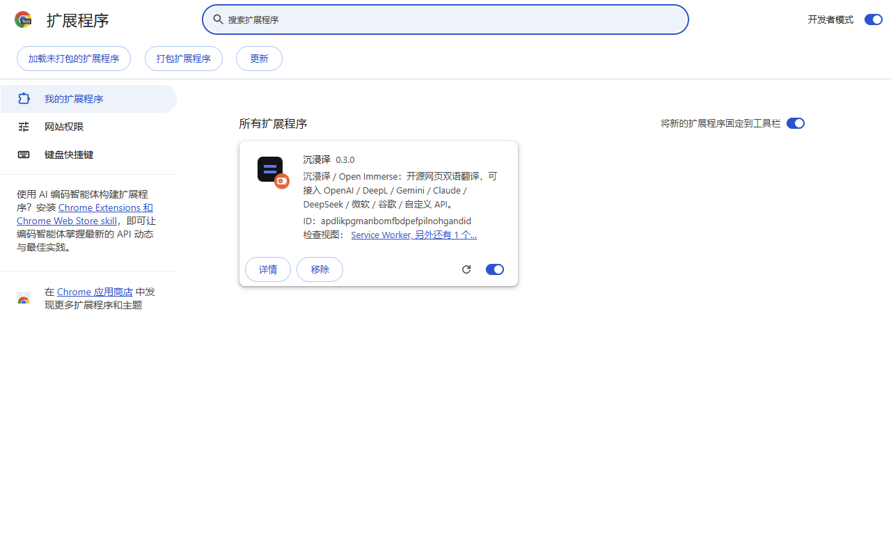

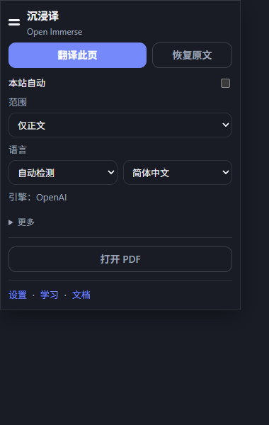

To load a git checkout, point Load unpacked at the repository root. The extension has no build step.

## Configure a translation model

Open **设置** (Settings) from the popup and go to **翻译** (Translation). Pick an engine, fill in the key, base URL, and model that engine asks for, then click **测试连接** (Test connection). Success reads 「连接成功 · Hello → …」. The v0.3.0 walkthrough used OpenAI / compatible with the model name `glm-5.3-flash`, and that line was 「连接成功 · Hello → 你好」. `glm-5.3-flash` is the name entered for that run. Built-in defaults are in the table below.

Leaving a field or pressing Enter saves. Keys are stored in `chrome.storage.local` under `oiSecrets`. They are not written to `chrome.storage.sync`. The settings row 「在我的浏览器之间同步密钥」 is present and cannot be turned on in this version.

If no translation engine is selected and **多模态 · OCR** already has a usable model, translation borrows that model. The key still stays on the machine. If neither is configured, the UI asks you to open Settings. MyMemory can be selected by hand. It is not the default engine, and it is not the automatic fallback when nothing is configured.

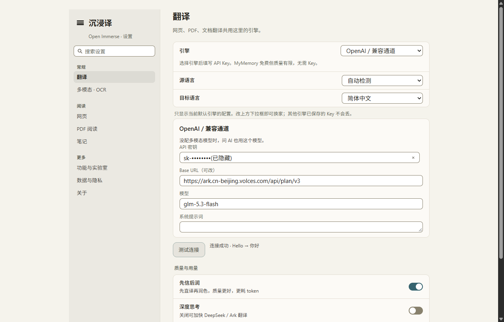

The service worker sends every translation request. Content scripts do not call translation APIs themselves.

| id | Name | Kind | Default |
| --- | --- | --- | --- |
| `mymemory` | MyMemory (free trial) | Machine translation | No key. Optional email. Select it by hand |
| `microsoft` | Microsoft Translator | Machine translation | Region `eastasia`, endpoint `https://api.cognitive.microsofttranslator.com` |
| `deepl` | DeepL | Machine translation | Free uses `api-free.deepl.com`; Pro uses `api.deepl.com` |
| `google` | Google Cloud Translation | Machine translation | Cloud Translation v2 |
| `openai` | OpenAI / compatible | LLM | `https://api.openai.com/v1`, model `gpt-4o-mini` |
| `kimi` | Kimi / Moonshot | LLM | Base URL `https://api.moonshot.cn/v1`, model `kimi-k2.5`. A region field is also shown. A filled Base URL is the address that is called. With an empty Base URL, the international region uses `https://api.moonshot.ai/v1` |
| `minimax` | MiniMax | LLM | Base URL `https://api.minimax.cn/v1`, model `MiniMax-M2.5`. A region field is also shown. A filled Base URL is the address that is called. With an empty Base URL, the international region uses `https://api.minimax.io/v1` |
| `grok` | xAI Grok | LLM | `https://api.x.ai/v1`, model `grok-4-fast` |
| `openrouter` | OpenRouter | LLM | `https://openrouter.ai/api/v1`, model `openrouter/free`. Optional HTTP-Referer and X-Title |
| `gemini` | Google Gemini | LLM | Model `gemini-2.0-flash` |
| `claude` | Anthropic Claude | LLM | Model `claude-3-5-haiku-latest` |
| `azure` | Azure OpenAI | LLM | Endpoint, deployment, API version (default `2024-10-21`) |
| `custom` | Custom HTTP | Custom | URL, method, headers JSON, body template, response path |

There is no separate engine row for a local OpenAI-compatible server. Choose `openai`, set Base URL to that server, for example `http://127.0.0.1:11434/v1`, and put the local model name in Model. `custom` can assemble the request instead.

The language list is `lib/languages.js`: auto-detect, Simplified and Traditional Chinese, English, Japanese, Korean, and common European and Asian languages. Machine-translation engines map those codes to each vendor’s API. The default source language is auto-detect. The default target is `zh-CN`.

LLM engines default to **先信后润** (faithful draft, then polish) under Settings → 功能. The second pass uses more tokens and can be turned off. A custom system prompt skips that pass. **深度思考** (deep thinking) is off by default. `thinking` / `reasoning_effort` are attached only when the base URL or model looks like Volcengine Ark or DeepSeek.

## Update

If the extension was installed with Load unpacked, keep the same folder path.

1. Download the new zip from [Releases](https://github.com/wisdom-km/open-immerse/releases) and unzip it.
2. Replace the files in the folder you originally loaded.
3. Open `chrome://extensions` and click **重新加载** (Reload) on the 沉浸译 card.

An unpacked extension’s ID is derived from the folder’s absolute path. When that path stays the same, reload keeps settings, keys, and notes. Settings are in `chrome.storage`. Notes and PDF translations are in IndexedDB for that extension ID. Loading a different folder creates another extension ID, and the previous local data stays on the old ID. Removing the extension from the list also clears local data for that ID.

For a git checkout, pull the update and click Reload on the extensions page.

## Privacy and permissions

Open Immerse does not run its own translation server. The background sends each request to the engine URL you entered. Diagnostic records stay on the machine until you decide to share an export.

Permissions in `manifest.json`:

| Permission | Why it is there |
| --- | --- |
| `storage` | Non-secret settings go to `chrome.storage.sync`. API keys live in `chrome.storage.local` under `oiSecrets`. Learning items are in local storage as well. |
| `activeTab` | Acting on the current tab from the toolbar icon or the shortcut. The popup and `Alt+T` message that tab through `chrome.tabs`. |
| `scripting` | The popup calls `chrome.scripting.executeScript` to tell whether the current tab is a PDF. |
| `contextMenus` | The selection context-menu item 「收藏」 (Save), which writes to the learning center. |
| `alarms` | Declared in the manifest. The current code does not call `chrome.alarms`. |
| `nativeMessaging` | When the PDF layout mode is `local-ocr`, the service worker connects to the native host `com.open_immerse.glmocr` and sends `{ action: "ensure" }` to check that local GLM-OCR is up. The default reader uses the text layer and does not open this connection. If that host is not installed, the connection fails and the reader stays on the text layer. |
| `host_permissions`: `<all_urls>` | Content scripts insert translations on pages you open, and the background calls whatever translation API you configured. PDF reader files are also exposed as `web_accessible_resources` for `<all_urls>`. |

Content scripts inject at `document_idle` on `<all_urls>`: `lib/fab.js`, `lib/bilingual-layout.js`, `content/content.js`, `content/toolbar.js`, `content/subtitles.js`, plus `ui/tokens.css` and `content/content.css`. `ui/tokens.css` currently sets `color-scheme: dark` on `:root`, so that injection reaches the host page. That is the first known limitation below.

The shortcut `Alt+T` starts translation on a web page. Pressing it again restores the original.

## Diagnostics

When something goes wrong: Settings → **关于** (About) → **导出诊断包** (Export diagnostics).

The file is JSON, named like `open-immerse-diagnostics-0.3.0-*.json`. It contains up to 7 days of runtime records, error reasons, the version, and browser information, plus a settings summary with no keys. API keys, tokens inside URLs, and paper body text are removed before export. The extension does not upload the file.

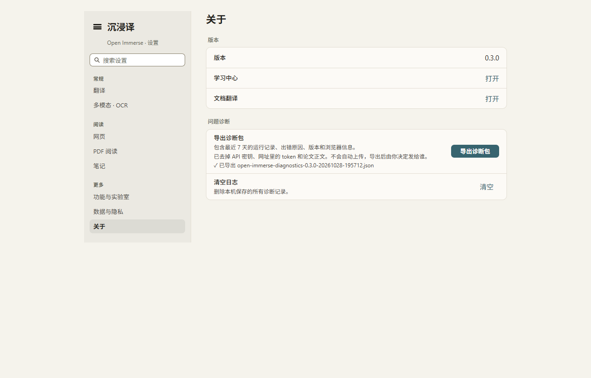

The same page can clear the local diagnostic log. The log is `diag.events` in `chrome.storage.local`, kept for 7 days, with a 2 MB cap.

## Known limitations

These come from the v0.3.0 install walkthrough. This version does not change the code for them.

1. **Webpage colors.** Content scripts inject `ui/tokens.css` on `<all_urls>`. The file starts with `:root { color-scheme: dark; }`, which applies to the host page’s `<html>`. In the walkthrough the computed `colorScheme` was `dark`. A page that does not set its own background can end up with dark text on a dark background. The translation blocks are still inserted. Keeping `color-scheme` on the extension’s own elements, or keeping that `:root` rule out of the content-script injection, avoids it.
2. **Webpages default to the title and the first paragraph.** That is the current `translateLimit: title_lead` behavior. Set 「本次翻译」 to 「全部」 for the rest of the page.
3. **arXiv source and the selection toolbar.** After switching to arXiv source, selecting translated text in that same open may not show the selection toolbar. A refresh brings it back. The walkthrough reproduced this once, and the cause is not identified. Source mode itself is not remembered unless **以后自动** is checked.
4. **Note Markdown title.** `lib/notes-io.js` uses 「未命名论文」 when the document has no title. The export does not fill in the paper title on its own.
5. **Length of the opening clip.** `04-pdf-open-translate-hero` covers about the first 30 seconds after open. Full-document translation continues past what the clip shows.

Hover translate, selection translate, YouTube captions, and X captions exist in the code. They are off by default in `features.js` and do not appear in the main UI.

The learning center stores words and sentences for review. The documents page translates TXT, MD, and HTML by segment. Both are linked at the bottom of the popup and under Settings → About.

## Roadmap

The v2 desktop app and the optional layout mode are written up in the docs. They are not in this version.

- The desktop app is an Electron app for Windows and macOS. Scope: [`docs/desktop-plan.md`](docs/desktop-plan.md). The extension stays zero-build.
- Layout analysis runs on the desktop app. The default tier matches this extension and follows text-layer order. **智能版式** (smart layout) runs local PP-DocLayoutV2 only after the user turns it on. The browser extension does not load that layout model. See section 11 of [`docs/architecture-redesign.md`](docs/architecture-redesign.md).

## Develop

The extension is zero-build. After editing JS, CSS, or HTML, click Reload on `chrome://extensions`.

```bash
node --test tests/*.test.mjs
```

`package.json` asks for Node.js 20 or newer. The test command does not need those dependencies installed first. The dependencies in `package.json` are for the labeling and check scripts.

Conventions are in [CONTRIBUTING.md](CONTRIBUTING.md) (Chinese). Do not commit API keys, `.env` files, or zip archives.

## License

[MIT](LICENSE) © 2026 wisdom-km

Third-party components shipped with the reader:

- [pdf.js](https://github.com/mozilla/pdf.js) 4.10.38 (Apache-2.0) in `pdf/vendor/`. Patch notes: [`docs/vendor-pdfjs.md`](docs/vendor-pdfjs.md).
- [KaTeX](https://github.com/KaTeX/KaTeX) 0.18.7 (MIT) in `pdf/vendor/katex/`.
- [markdown-it](https://github.com/markdown-it/markdown-it) 14.1.0 (MIT) in `pdf/vendor/markdown-it/`. The reader page loads it.
- A Latin font bundled with the reader, CSS name “OI Serif Latin”. SIL OFL 1.1, reserved font name Source. The license text is `pdf/fonts/OFL.txt`.
