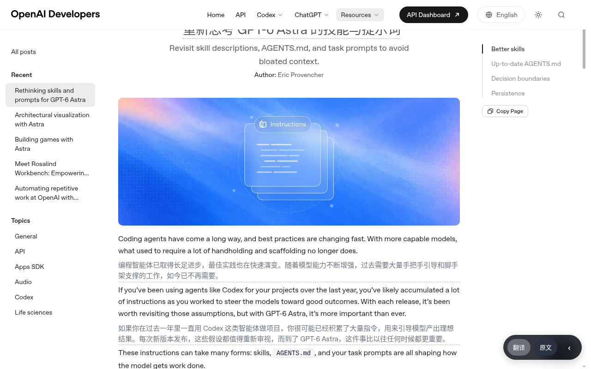
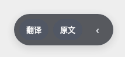
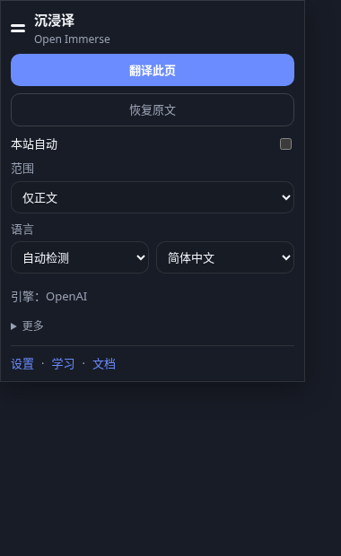
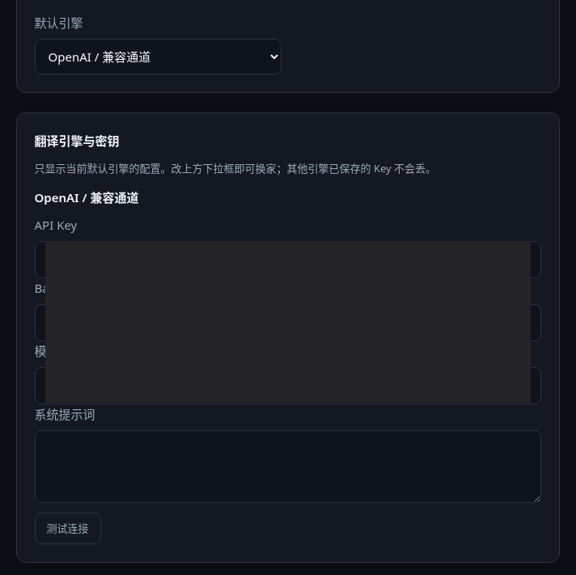
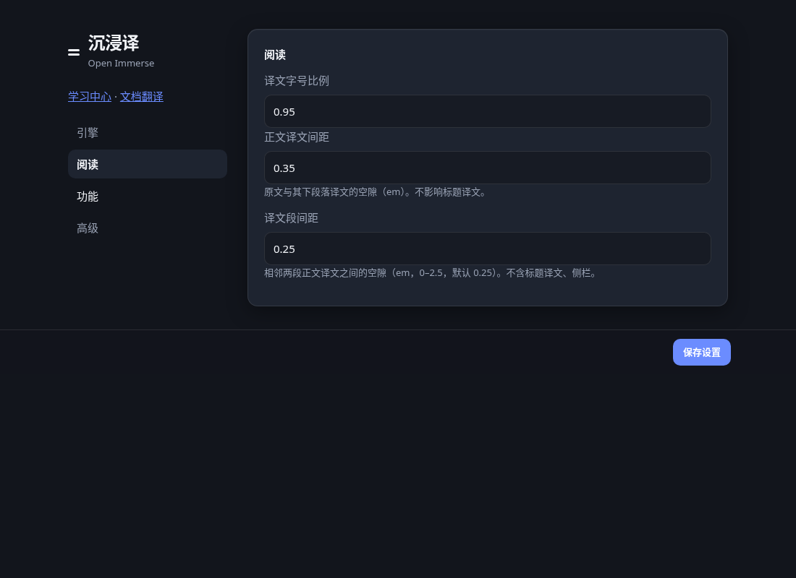
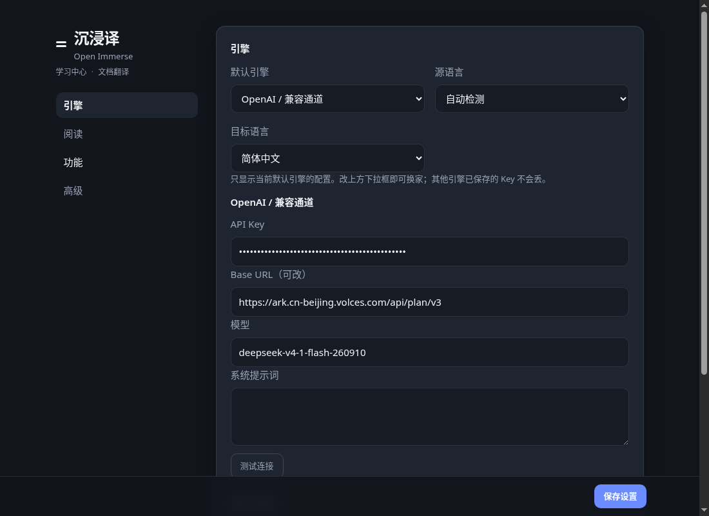
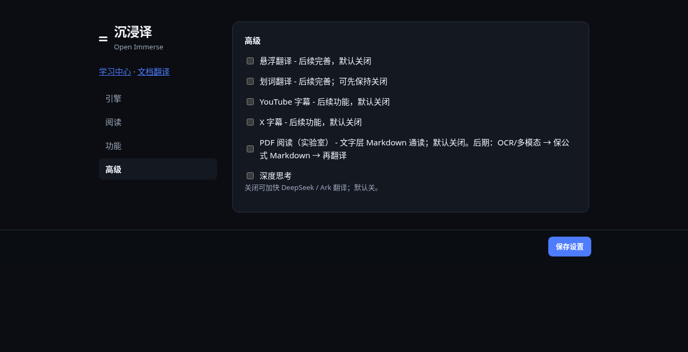
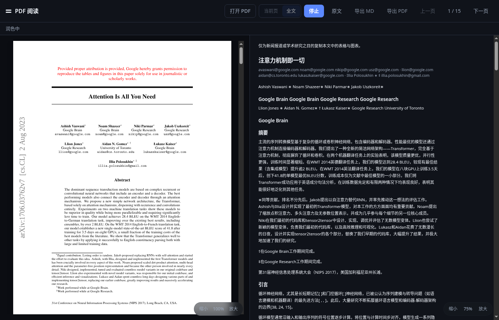

# 沉浸译 / Open Immerse

**中文** · [English](README.en.md)

开源 Chrome **网页双语翻译** 扩展（Manifest V3）。

把外文网页、纯文本文档译成对照阅读；密钥自己填，引擎自己换。仓库：https://github.com/wisdom-km/open-immerse

当前版本 **0.3.0**。V1 先做好网页双语。学习中心与文档翻译可用。**PDF 阅读默认开启**，开关在 **设置 → PDF 阅读** 页顶，不再放在实验室。目标是：文字层正文 + 原页内容精准展示（默认裁图）；公式可来自核对过的 LaTeX（KaTeX）渲染，判不出时显示原页裁图。不是把译文贴进左栏。YouTube / X 字幕、悬浮翻译、划词卡片代码还在，**默认关闭，不出现在主界面**。

与官方「沉浸式翻译」无隶属关系。

---

## 能做什么

| 模块 | 现状 |
| --- | --- |
| 页面开关（FAB） | 右下角玻璃胶囊：翻译 / 停止、原文、‹ 收起。可拖动，位置写入设置。仅翻译中（含润色）显示「停止」；停止只中止 inflight，**保留已出译文**。「原文」才清译文。 |
| 网页翻译 | 默认 **仅正文**（`main` / `article` 主栏，不含侧栏、导航）。可切「全页面」（含侧栏短目录）。页头主 H1 尽量必译：原文在上、译文在下；标题译文字号跟正文译文走，不跟着 H1 放大；标题原文与译文的光学空隙会收紧（仅文章主栏）。顶栏导航链、面包屑、cookie 条、页脚链接堆仍跳过。 |
| 本次翻译额度 | `全部` 或 `仅标题+开头`（H1 + 第一段正文，开头段最多约 3 行 / 220 字）。「每批条数」只决定一次请求翻几段，不是本页总数。 |
| 学习中心 | 收藏单词 / 短语 / 句子；全部 / 今日待复习（简化 SM-2）；导出 Markdown / PDF / Word。 |
| 文档翻译 | TXT / MD / HTML 直读分段双语，译文可改，失败可重试，导出 HTML。 |
| 先信后润 | **默认开**（**设置 → 功能**，不在高级里）。LLM 先忠实直译，再润色一稿；质量更好、更耗 token。可关。仅 LLM 引擎生效；自定义系统提示词则跳过第二步。 |
| PDF 阅读 | **默认开启**（设置 → PDF 阅读，页顶开关，可关）。已安装且把 `features.pdf` 存成 `false` 的，升级迁移会打开一次，并写入 `migrationNotes.pdfFlippedAt`。提示只在写了这个时间时出现：设置页开关正下方，以及升级后第一次打开 PDF 时阅读器顶部（这句链到「设置 › PDF 阅读」）。点「知道了」、关掉 PDF 阅读，或任一处看过一次，就在本机记下 `oi.notice.pdfDefaultOn`，两处都不再显示。新安装和本来就是开的，不写时间、不提示。版本已是 9 之后再关掉会保持关闭。目标：文字层正文 + 原页内容精准展示（默认裁图）；公式可来自核对过的 LaTeX（KaTeX）渲染，判不出时显示原页裁图。笔记（#122）：侧槽或三栏、划线、导出导入。arXiv 源码（#124）：默认关，点了才下。公式、图、表跟打开的 PDF 是同一套内容。有文字层的正文用文字层原句。译文只在右栏。测试期划区用本机智谱 GLM-OCR，上线用 OCR API 加已配置的大模型 API。**网页双语仍是主产品。** |
| 快捷键 | `Alt+T`：开译 / 恢复原文（关即清译文）。 |

建议回归页（主栏扫描、标题口径都按这类博客调过）：  
https://claude.com/blog/what-1-000-small-business-owners-taught-us-about-ai

---

## 界面预览

弹层与设置页是 **Soft Graphite** 壳层：分层石墨底、卡片层次更安静，强调色 `#6b8cff`。

**网页双语与 FAB**



原文下方中文译文，右下角玻璃胶囊。



翻译 / 原文 / 收起。可拖动，位置写入设置。

**弹层**



主卡片：「翻译此页」（进行中变为「停止」）、次按钮「打开 PDF」、「恢复原文」、本站自动、范围与语言。额度在折叠的「更多」。**没有进度条。** 底栏是 **设置 · 学习 · 文档**。PDF 阅读默认开着，弹窗里常显「打开 PDF」（在「翻译此页」下方）：当前标签是 PDF 时用阅读器打开该文件，其他页打开阅读器文献库。关掉「PDF 阅读」后这个按钮隐藏。

**设置四组：引擎 / 阅读 / 功能 / 高级**

左侧栏标题下是弱化的 **学习中心 · 文档翻译**（不是强调色按钮），其下四个分组。已定改成 8 个一级页，页名见 [`docs/settings-spec.md`](docs/settings-spec.md)（`#translate` 翻译、`#mm` 多模态 · OCR、`#web` 网页、`#pdf` PDF 阅读、`#notes` 笔记、`#labs` 功能与实验室、`#data` 数据与隐私、`#about` 关于）。「多模态 · OCR」是一级页（常规组第 2 位），不是一节。问 AI 不再单独设一页（2026-10-13 12:19–12:23，规格 2026-10-13 13:01 Wisdom 批准，SET-01…SET-34）。已合（#137）。上面的四组和下面的截图是重设计之前的界面。PDF 阅读的开关在设置页「PDF 阅读」页顶，默认开启。



**引擎**：当前默认引擎的密钥、Base URL、模型与测试连接（截图已打码）。



**阅读**：只有译文字号比例、正文译文间距、译文段间距。没有译文样式下拉或预览表。



左侧栏：弱化的「学习中心 · 文档翻译」+ 引擎 / 阅读 / 功能 / 高级。



**功能与实验室**：悬浮 / 划词 / 字幕默认关。**PDF 阅读**不在这一页，开关在 **设置 → PDF 阅读** 页顶，默认开。**先信后润** 在 **功能** 组（默认开）。

**PDF 阅读**



默认开启。开关在 **设置 → PDF 阅读** 页顶。

---

## 安装

需要 Chrome 114+（或其它基于 Chromium、支持 MV3 module service worker 的浏览器）。

```bash
git clone https://github.com/wisdom-km/open-immerse.git
```

1. 打开 `chrome://extensions`
2. 打开「开发者模式」
3. 「加载已解压的扩展程序」，选中仓库根目录（含 `manifest.json` 的那一层）

已装过的：`git pull` 后在扩展页点 **重新加载**。不要点「移除」再装——密钥在 `chrome.storage.local`，移除扩展会清掉（设置页重设计 #137 已把密钥从 sync 迁到 local，2026-10-13 12:19–12:23）。导出不含 key，导入设置也不写入 key（2026-10-13 17:29），导出不能用来保住密钥。

本仓库 **零构建**：改 JS / CSS / HTML 后重新加载即可，没有打包步骤。

---

## 怎么用

### 1. 配引擎

工具栏图标 → **设置**，或右键扩展图标 → 选项。

1. 选默认引擎
2. 填 API Key / Base URL / 模型（视引擎而定）
3. 点「测试连接」
4. 离开输入框或按回车即保存（#137 起没有「保存设置」按钮）

没有配置翻译引擎时，会借用已配置的多模态模型翻译（#176）；两者都没有时提示去设置。MyMemory 仍可手动选择，但不是默认，也不作兜底。

已定改为即时保存，去掉「保存设置」；密钥在离开输入框或按回车时提交。空白输入（未点 ×、也未把原值删成空串）不覆盖已存密钥；清除用框尾 ×，无眼睛、无撤销，失焦或回车自动保存，点 × 立刻写空（SET-05、SET-06、SET-07，2026-10-27）（2026-10-13 12:19–12:23，已合 #137）。所有密钥只存 `chrome.storage.local`，不进 sync。翻译密钥和 PDF 云端密钥已从 sync 迁到 local。2026-10-13 17:29 Wisdom 定：导出拆成「文献库」和「设置」两个文件，都不含任何 API key；设置导出不带 key，导入设置也不写入 key。见 `docs/settings-spec.md` §2。密钥是否跟账号同步由用户选择，沿用 11:57 预留的接口，随 F11 执行（F10 并入 F11，2026-10-18）。笔记面板偏好（面板宽度、筛选、「不再提示」等）从 `localStorage` 改存 `chrome.storage.local`，和其他设置放在一起（2026-10-13 11:55 定，12:00 确认）；旧值自动迁移，不能丢，已合入（#130，`4e0a705`）。键是 `reader.panelWidth`、`reader.notesWidth`、`reader.notesPaneSide`、`reader.notesPersistHintDismissed`（一个键，值是 docHash 到 true 的映射）。问 AI 不再单独设一页，也不单独配模型。

### 2. 译网页

打开外文页，点右下角 **翻译**。

| 动作 | 效果 |
| --- | --- |
| 翻译 | 按当前范围与额度扫描节点，分批发给后台 |
| 停止 | 中止未完成请求，已插入的译文留下 |
| 原文 / 弹层「恢复原文」 | 清掉本页全部 `.oi-translation`，回到「翻译」 |
| 弹层「翻译此页」 | 开译；进行中变为「停止」（只中止，不清译文） |
| `Alt+T` | 开译；再按一次恢复原文 |

弹层里还可以改：本页范围、源/目标语言、本站自动；本次额度在「更多」。底栏是 **设置 · 学习 · 文档**。PDF 阅读默认开启，弹窗里常显次按钮 **打开 PDF**（在「翻译此页」下方）：当前标签是 PDF 时用阅读器打开该文件，其他页打开阅读器文献库。在 **设置 → PDF 阅读** 关掉开关后，这个按钮隐藏。

译文字号比例和正文间距在 **设置 → 阅读**。只有字号比例 + 两个间距；不再提供译文样式下拉或预览表。

间距（设置 → 阅读，数字输入；**只作用于正文段落，不含标题和侧栏**）：

- **正文译文间距**（`bodyGlossGap`）：每个原文块与其下方译文的空隙，约 0.10–0.70（em 量级）
- **译文段间距**（`bodyGlossStackGap`）：相邻两段正文译文之间的额外空隙，范围 **0–2.5**；设成 0 / 1 / 2 时肉眼可辨

**设置 → 功能** 里的 **先信后润**（`twoStepPolish`，**默认开**）：LLM 先忠实直译，再润色一稿；质量更好、更耗 token。可关。仅 LLM 引擎生效。

### 3. 收藏与复习

- 选中文本 → 右键 **收藏**（会先译再入库）
- 双击已插入的译文也可收藏
- 学习中心：全部列表，或「今日待复习」三档（忘了 / 模糊 / 记住）

条目存在 `chrome.storage.local`（`oiLearning`），与设置同步存储分开。

### 4. 文档

弹层 → **文档**，或设置页左侧标题下的 **文档翻译**。粘贴或读入 TXT / MD / HTML，分段翻译，右侧可改译文，导出 `open-immerse-bilingual.html`。

不支持版式还原的 Office / 扫描件；可先转纯文本。扫描件请等实验室 OCR 路线，或自行转 Markdown。

### 5. PDF 阅读（默认开启）

**默认入口。** 新安装 `features.pdf` 为开，不写 `pdfFlippedAt`，也不出现提示。开关在 **设置 → PDF 阅读** 页顶，文案是「PDF 阅读」。关掉后，弹窗里常显的「打开 PDF」按钮隐藏。升级时只有存成 `false` 的才会被打开一次，并在设置页开关下和阅读器顶部各出现一次提示。阅读器那句链到「设置 › PDF 阅读」。

目标：文字层正文 + 原页内容精准展示（默认裁图）。右栏仍是 **Markdown 通读**，按阅读顺序排译文。公式可来自核对过的 LaTeX（KaTeX）渲染，判不出时显示原页裁图。规格见 `pdf/PDF-MD-READOUT.md`。阅读器运行路径按 `pdf/high-precision/EXECUTION.md` 分阶段接上。

- 笔记（#122）：侧槽或三栏，划线，导出和导入
- arXiv 源码（#124）：默认关，认出编号后点了才下载
- 左栏：pdf.js 连续滚动；缩放只作用于原页
- 顶栏：已译 n / t 页 → 打开 PDF → 翻译 → 重译本页 → 停止（只在翻译进行时显示）→ 原文 → 上一页 → 页码 → 下一页 → Aa。导出 MD / PDF 在「···」菜单里，不是顶栏按钮。Aa 字号范围 14–40，按栏宽封顶（#116）。打开后自动翻译全文。设置 → PDF 阅读里可关「打开 PDF 时自动翻译全文」
- 重开时按当前文字层的活块核对本地库。每一块都要有自己的落地译文才算这一页译完；库对少于活块，或长段译文仍等于原文，该页进队补译，顶栏不能先写「全文已译」。摘要和脚注拆开存。不超过 3 个词、或没有字母的短段原样返回，仍算不需翻译
- 全文按页 `OI_TRANSLATE_BATCH`，页内进度「正在翻译 · k / m 段」，可停；停或译完主按钮立刻回「翻译」，已译中文保留
- **原文只切换视图**，不中止翻译，也不清缓存
- 右栏走 **Markdown 通读流**：按阅读顺序抽出标题 + 正文再翻译，连续滚动；译文只出现在右栏，**不是**把译文贴进左栏
- 右栏另有独立缩放芯片（0.5–5，步长 0.25），不进顶栏
- 中缝可拖，改左右栏宽度
- 内容精准第一，排版第二且尽量做好。译文跟抽出的原文一致。公式、图、表跟打开的 PDF 是同一套内容，默认用原页裁图（pageRaster）；其他手段须过同一条验收
- 公式多模态的豆包预设默认地址是 `https://ark.cn-beijing.volces.com/api/plan/v3`（glm-5.3-flash，另一预设 deepseek-v4.1-flash）。Base URL 留空就用这个地址。已经保存的地址保持不变。按量密钥可以手动改成 `https://ark.cn-beijing.volces.com/api/v3`
- 有文字层的正文用文字层原句。点击右栏用左栏高亮对齐
- OCR 把 `i` 认成 `n`，或把 `n` 认成 `i`，不上屏，也不送进翻译
- 测试期划区用本机智谱 GLM-OCR。上线用 OCR API，翻译用插件里已经配置的大模型 API
- 不注入 Chrome 自带 PDF Viewer。没有可信文字层时，正文才用识别结果，并标明可能有误差；图、表仍是原页裁图；公式按回退链，判不出时显示原页裁图
- 网页双语仍是主产品与回归标准

---

## 引擎

所有请求由 **service worker** 发出。内容脚本不直接打外网。

| id | 名称 | 类型 | 默认 |
| --- | --- | --- | --- |
| `mymemory` | MyMemory（免费试用） | 机器翻译 | 手动可选，非默认，非兜底。可选 Email 提高额度 |
| `microsoft` | Microsoft Translator | 机器翻译 | Region 默认 `eastasia` |
| `deepl` | DeepL | 机器翻译 | Free / Pro 主机切换 |
| `google` | Google Cloud Translation | 机器翻译 | Cloud Translation v2 |
| `openai` | OpenAI / 兼容通道 | LLM | `https://api.openai.com/v1` · `gpt-4o-mini` |
| `kimi` | Kimi / 月之暗面 | LLM | 国内 `api.moonshot.cn` / 国际 `api.moonshot.ai` · `kimi-k2.5` |
| `minimax` | MiniMax | LLM | 国内 `api.minimax.cn` / 国际 `api.minimax.io` · `MiniMax-M2.5` |
| `grok` | xAI Grok | LLM | `https://api.x.ai/v1` · `grok-4-fast` |
| `openrouter` | OpenRouter | LLM | 可填 HTTP-Referer / X-Title |
| `gemini` | Google Gemini | LLM | `gemini-2.0-flash` |
| `claude` | Anthropic Claude | LLM | `claude-3-5-haiku-latest` |
| `azure` | Azure OpenAI | LLM | endpoint + deployment + apiVersion |
| `custom` | 自定义 HTTP | 任意 | URL / method / headers JSON / body 模板 / responsePath |

**Ollama 与其它本地 OpenAI 兼容服务**：没有单独厂商项。选 `openai`，把 Base URL 改成例如 `http://127.0.0.1:11434/v1`，模型填本地名即可。或用 `custom` 自己拼请求。

语言选项以 `lib/languages.js` 为准（自动检测 + 简繁中 + 英日韩及常见欧亚语）。机器翻译引擎会再映射到各家语言码。

### LLM 质量策略

所有 LLM adapter 走同一套 Skill：`lib/translate-skill.js`。

- **设置 → 功能** **先信后润**（`twoStepPolish`，**默认开**）：先忠实直译，页面先插入草稿并 toast「润色中」，再换成终稿。质量更好、更耗 token。可关。仅 LLM 引擎生效。润色失败保留草稿，短 toast「润色失败」
- 这是普通语际转换（如英 → 现代汉语），**不是文言文**
- 引擎里填了自定义系统提示词 → 仍单次，跳过第二步
- 中文目标会追加 glossary hint，并在解析后跑两道安全网：`guardZhBusinessSense`（避免 “business owners” 融成「主教」）、`guardZhTitleCalques`（去掉标题空套话）

### 深度思考

设置 → 高级 **深度思考**（`deepThink`，默认关）。

仅当 Base URL / 模型像 **Ark（火山）或 DeepSeek** 时才会带 `thinking` / `reasoning_effort`：

- 关：`thinking.type=disabled`，并带 `reasoning_effort=minimal`
- 开：`thinking.type=enabled`

其它引擎不带这些字段，避免 400。网页、PDF、文档共用这两个开关。

---

## 权限与数据

`manifest.json` 申请了：

- `storage`：设置（sync）+ 学习条目（local）。密钥将只存 local（待实现）
- `activeTab` / `scripting`：当前页启停
- `contextMenus`：右键收藏
- `alarms`：预留
- `host_permissions: <all_urls>`：任意页注入内容脚本，并由后台代发各家翻译 API

内容脚本在 `document_idle` 注入：`lib/fab.js`、`lib/bilingual-layout.js`、`content/content.js`、`content/toolbar.js`、`content/subtitles.js`。

翻译结果在 service worker 内存里缓存最多 2000 条（重启扩展即丢）。缓存 key 含引擎、语言、是否两步、是否思考，避免串味。

---

## 目录

```
open-immerse/
├── manifest.json              # MV3，版本 0.3.0
├── background/
│   ├── service-worker.js
│   ├── arxiv-source.js        # arXiv 源码下载与缓存（#124）
│   └── formula-cache.js       # 公式缓存；SW 静态导入（AX-23，2026-10-13 10:36）
├── content/                   # DOM 扫描、插入译文、字幕桩
├── popup/                     # 工具栏弹层
├── options/                   # 设置页
├── learning/                  # 学习中心页
├── documents/                 # 文档翻译页
├── pdf/                       # 自有阅读器 + 设计笔记
│   ├── viewer.html|js|css
│   └── vendor/                # pdf.js 4.10.38 · KaTeX 0.18.7
├── lib/
│   ├── providers.js           # 全部引擎 adapter（HTTP 经 lib/net）
│   ├── net/fetch.js           # 统一出口：超时、重试、去重、缓存、日志打码
│   ├── platform/              # 扩展 / 桌面适配；net 可换 transport
│   ├── translate-skill.js     # 共用 Skill / 两步提示词
│   ├── storage.js             # 默认设置与迁移（settingsVersion = 9）
│   ├── page-scan.js           # 节点收集（与 content.js 保持一致）
│   ├── site-presets.js        # 站点预设（目前 claude.com）
│   ├── bilingual-layout.js    # 双语排版
│   ├── pdf-readout.js         # PDF 右栏 Markdown 通读（产品路径）
│   ├── pdf-mirror.js          # 抽取辅助；bbox 镜像不是产品路径
│   ├── pdf-viewer.js          # 阅读器逻辑（供 viewer 与测试）
│   ├── pdf-latex.js           # 文字层回收 LaTeX
│   ├── notes-*.js             # 笔记存储、锚点、界面（#122）
│   ├── formula-*.js           # 公式回退链、KaTeX、缓存（F3）
│   ├── arxiv-*.js             # arXiv 编号、解包、对齐（#124）
│   ├── learning.js            # 收藏与间隔复习
│   ├── export.js              # MD / 简易 PDF / docx
│   ├── translate-limit.js     # 标题+开头额度
│   └── features.js            # 功能开关
├── docs/screenshots/          # README 界面预览
├── docs/vendor-pdfjs.md       # vendored pdf.js 补丁记录
├── ui/tokens.css
├── tests/*.test.mjs
├── _locales/zh_CN|en
├── README.md                  # 中文
├── README.en.md               # English
└── CONTRIBUTING.md
```

数据流：

```
页面 / PDF / 文档
    → chrome.runtime.sendMessage({ type: "OI_TRANSLATE_BATCH" })
        → service worker：缓存命中或 providers[id].translate()
            → （可选）OI_TRANSLATE_PROGRESS phase=draft
        ← translations[]
    → 插入 .oi-translation 或 PDF 通读块
```

内容脚本 **不** `fetch` 翻译 API。厂商请求从 `lib/providers.js` 进 `lib/net/fetch.js`，不在页面里直连。新增引擎只改 `lib/providers.js` 与 `DEFAULT_SETTINGS.providers`。

---

## 开发

```bash
# 纯函数测试（Node 18+，零依赖）
node --test tests/*.test.mjs
```

约定见 [CONTRIBUTING.md](CONTRIBUTING.md)。要点：

- 一个 PR 一件事；不要提交 Key、`.env`、zip
- `content/` 只动 DOM；网络与缓存只在 `background/`
- 弹层「翻译此页」只表示本页是否在译：以当前页 `OI_PING.inflight`（`html.oi-active`）为准，不要用全局 `enabled` 冒充本页状态。「停止」走 `OI_STOP`/`abort()`；「恢复原文」才 `OI_RESTORE`
- PDF 阅读器没有「当前页 / 全文」分段，不要加回去，也不要和网页扫描逻辑混改
- 网页扫描：`article` 只收主栏；`page` 另收侧栏可读段，并用启发式收 header 里的文章 H1，禁止 `closest('header')` 一刀切

### 新增引擎

1. 在 `providers` 里加 `{ id, name, kind, fields, translate }`
2. `translate(texts, ctx)` 必须返回与输入等长的 `string[]`
3. 密钥只从 `ctx.settings` 读
4. LLM 走 `resolveTranslatorPrompt` + `translateWithSkill`，模型从 `ctx.settings.model` 读
5. 在 `DEFAULT_SETTINGS.providers` 和本文引擎表各补一行

---

## 现状与边界（0.3）

已经能日常用的：网页主栏双语、站点自动规则、学习复习、纯文本文档。

明确没做、不保证、或仍实验：

| 项 | 说明 |
| --- | --- |
| **PDF 阅读（默认开）** | `features.pdf` 默认 `true`。开关在设置 → PDF 阅读页顶。旧安装里存成 `false` 的，升级迁移会打开一次并写入 `migrationNotes.pdfFlippedAt`；提示在设置页开关下和阅读器顶部（阅读器那句链到「设置 › PDF 阅读」），看过一次、点「知道了」或关掉后写入 `oi.notice.pdfDefaultOn`，不再出现。本来就是开的和新安装不写这个时间。版本已是 9 之后再关掉会保持关闭。目标：文字层正文 + 原页内容精准展示（默认裁图）；公式可来自核对过的 LaTeX（KaTeX）渲染，判不出时显示原页裁图。有文字层的正文用文字层原句。译文只在右栏。测试期划区用本机智谱 GLM-OCR，上线用 OCR API 加已配置的大模型 API。网页双语仍是主产品 |
| 侧栏英/中配对 | 搁置；产品焦点是正文双语 |
| Chrome 网上应用店 | 目前只支持加载已解压目录 |
| OCR | 无可信文字层时，正文才用识别结果，并标明可能有误差。图、表仍是原页裁图；公式按回退链，判不出时显示原页裁图。把 `i` 认成 `n` 或把 `n` 认成 `i` 不上屏 |
| DOCX / 复杂排版文档 | 文档页只吃纯文本类文件 |
| 悬浮 / 划词 / 字幕 | `features.js` 里 `group: "later"`，默认关 |
| 独立 Ollama 项 | 用 OpenAI 兼容通道 |
| 译文缓存持久化 | 仅 SW 内存 |
| 密钥隔离 | 已定：所有密钥只存 `chrome.storage.local`。导出拆成「文献库」和「设置」两个文件，都不含任何 API key（2026-10-13 17:29，见 `docs/settings-spec.md` §2）。翻译密钥和 PDF 云端密钥的迁移在设置页重设计，已合（#137）。密钥是否跟账号同步由用户选择，沿用 11:57 预留的接口，随 F11 执行（F10 并入 F11，2026-10-18） |
| 全站像素级还原 | 网页是「段下落下」对照，不是重排整个 CSS 布局 |

---

## 文档

计划和现状以 [`docs/ui-phase2-plan.md`](docs/ui-phase2-plan.md) 为准，当前进度在「2026-10-28 决定」（代码 main `e8a6467`，#190；阅读顺序以同节 15:00–15:02 为准）。待你拍板的事在 [`docs/owner-todo.md`](docs/owner-todo.md)。

| 文档 | 内容 |
| --- | --- |
| [`docs/architecture-redesign.md`](docs/architecture-redesign.md) | 架构建议稿 v1.1（桌面读和写、手机听、共享知识库）。第 11 节是阅读顺序：v1 文字层原序；v2 在桌面做两档，可选「智能版式」；稳定块号在 `core/`，按页作废 |
| [`docs/postmortems/pr189-multimodal-swap.md`](docs/postmortems/pr189-multimodal-swap.md) | #189 整页多模态替换为什么在真机上没有收敛 |
| [`docs/v2-polish-checklist.md`](docs/v2-polish-checklist.md) | v1 不做的打磨，以及旗标打开时仍已知的三条失败 |
| [`docs/v2-layout-mirror.md`](docs/v2-layout-mirror.md) | 译文版面镜像，v2 定稿（2026-10-27） |
| [`docs/ai-models-spec.md`](docs/ai-models-spec.md) | 「AI 模型」设置页规格。页本身在 v2 |
| [`docs/plans/multimodal-first.md`](docs/plans/multimodal-first.md) | 2026-10-27 15:14 批准的多模态优先方案。14:34 之后不再是 v1 默认路径 |
| [`docs/research/reading-order.md`](docs/research/reading-order.md) | 阅读顺序调研：两两后继、PP-DocLayoutV2、PaddleOCR-VL、GLM-OCR，以及其它管线。未复核的数字和许可证仍标「待复核」 |
| [`pdf/high-precision/REQUIREMENTS.md`](pdf/high-precision/REQUIREMENTS.md) | PDF 阅读的需求正本 |
| [`docs/settings-spec.md`](docs/settings-spec.md) | 设置页规格 |

## 许可

MIT © 2026 wisdom-km

第三方：

- [pdf.js](https://github.com/mozilla/pdf.js) 4.10.38（Apache-2.0），见 `pdf/vendor/`。补丁记录见 [docs/vendor-pdfjs.md](docs/vendor-pdfjs.md)
- [KaTeX](https://github.com/KaTeX/KaTeX) 0.18.7（MIT），见 `pdf/vendor/katex/`
- [Source Serif 4](https://github.com/adobe-fonts/source-serif) 4.005R（SIL OFL 1.1，保留字体名 Source）。阅读器打包的是拉丁子集，CSS 名「OI Serif Latin」，见 `pdf/fonts/OFL.txt`
