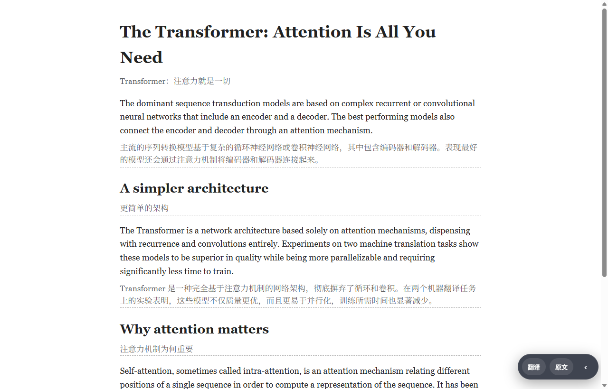

# 沉浸译 / Open Immerse

**中文** · [English](README.en.md)

开源 Chrome 扩展：论文 PDF 左边是原文，右边是译文。

[](https://github.com/wisdom-km/open-immerse/releases)
[](LICENSE)
[](manifest.json)

当前版本 **0.3.0**（走查基于提交 `a8a6efd`）。需要 Chrome 114 或更新。与商业产品「沉浸式翻译」没有隶属关系。

仓库：<https://github.com/wisdom-km/open-immerse>

截图里的 API 密钥是占位符。


打开一篇 PDF 之后，左栏是原文，右栏按段给出译文。上面这段动图来自 v0.3.0 对 arXiv [1706.03762](https://arxiv.org/abs/1706.03762)《Attention Is All You Need》的走查，只录了打开后的前约 30 秒，停在第一页开始出译文的时候。默认会继续把后面的页译完。同一段录屏的 MP4：[`04-pdf-open-translate-hero.mp4`](docs/assets/readme/04-pdf-open-translate-hero.mp4)。

## 它做什么

沉浸译把一篇外文论文放进扩展自带的阅读器里：左边用 pdf.js 显示原页，右边是对照译文。翻译请求发到你自己配置的模型，密钥留在本机。

v0.3.0 的一次安装走查里，PDF 这条路径是通的：安装、填写引擎、左右对照、公式、字号、插图、重译、笔记、再次打开、导出诊断包。网页双语可以在原文下插入译文。

这一版的阅读顺序来自 PDF 文字层抽出的顺序。浏览器扩展里不做版面重排。

## PDF 阅读

PDF 阅读默认开启。工具栏图标打开面板，点 **打开 PDF**：当前标签是 PDF 时，阅读器打开这份文件；其他页面则打开阅读器里的文献库。阅读器里也可以直接选择本地 PDF。

打开后默认翻译全文。开关在 **设置 → PDF 阅读**，名称是「打开 PDF 时自动翻译全文」。

### 左右对照


左栏连续滚动原文。右栏按阅读顺序排译文，译文只出现在右栏。走查用的那篇论文有 15 页，打开后自动开始全文翻译。

### 公式

默认把行间公式和行内公式按原 PDF 裁成图片嵌进译文，公式编号保留。裁图按 18 px 的参考字号绘制，不跟随下面的字号滑杆。


arXiv 论文可以改用源码公式。点顶栏的 **用 arXiv 源码** 之后，公式改为 LaTeX 源码，由仓库里的 KaTeX 渲染成可以选中的矢量公式。这个按钮默认不下载源码，点了才取。走查里状态栏显示「公式 · arXiv 源码 v7」，这一页共渲染 111 处 KaTeX。


源码模式默认不会记住。勾选旁边的 **以后自动**，下次打开才会沿用；不勾的话，重开后要再点一次。

### 字号

顶栏 **Aa** 里有字号滑杆。可选 14、15、16、17、18、19、20、22、24、26、28、32、36、40 px，默认 16。拖动时右栏译文立刻变大，也可以拖回 16。栏宽放不下最小可读行长时，上限会低于 40。KaTeX 公式用 `1.1em`，跟随右栏字号；原页裁图不跟随。

拖动滑杆即可放大译文。


同一段操作的 MP4：[`04-pdf-font-slider.mp4`](docs/assets/readme/04-pdf-font-slider.mp4)。

### 插图

译文里的插图以卡片显示。点开是大图，并标出原文页码。


### 笔记

在译文里选中一句，选区工具条点 **笔记**，写下内容。右侧笔记栏会保存。笔记存在扩展自己的 IndexedDB（库名 `oi-annotations`），和扩展文件夹不是同一份文件。


笔记栏的 **⋯** 菜单里有 **导出 Markdown**。走查导出的文件名是 `1706.03762-笔记.md`，里面有引用的原文和笔记正文。样例文件：[`05-notes-export-sample.md`](docs/assets/readme/05-notes-export-sample.md)。当前导出版本在没有论文标题时，Markdown 的标题会写成「未命名论文」，见「已知限制」。


同一段操作的 MP4：[`05-notes-select-to-note-hero.mp4`](docs/assets/readme/05-notes-select-to-note-hero.mp4)。

### 再次打开

关掉阅读页，再打开同一篇 PDF 时，已有译文从本机文献库读回，不会为了恢复再发一次翻译请求。笔记和高亮还在。

v0.3.0 走查对这篇论文重开了一次：大约 1.3 秒读回 145 段译文，笔记 1 条还在，期间没有新的翻译请求。


同一段操作的 MP4：[`06-reopen-restore.mp4`](docs/assets/readme/06-reopen-restore.mp4)。

### 重译

**重译本页** 旁的菜单里有三项：

| 菜单 | 作用 |
| --- | --- |
| 重译本页 | 只替换当前页 |
| 重译全文 | 从第 1 页起重新翻译 |
| 清空本文档译文… | 删除这篇的译文和公式缓存。笔记保留。清空后需要重新翻译 |


重译单页或全文时，笔记不受影响。

## 网页双语

网页翻译是附带能力。打开网页后，在面板里点 **翻译此页**，原文下面会出现译文。

默认额度是 **仅标题+开头**（`translateLimit: title_lead`）：页内标题，加上第一段正文。第一段还有长度上限，大约 3 行或 220 字，见 `lib/translate-limit.js`。设置 → 网页里把「本次翻译」改成 **全部**，才会继续翻译其余段落。「每批条数」只决定一次请求里放几段。

走查为了拍全页效果，临时改成了「全部」。新安装看到只有标题和第一段有译文，是当前默认值。



## 安装

从 [GitHub Releases](https://github.com/wisdom-km/open-immerse/releases) 下载 v0.3.0 的 zip，解压后加载。需要 Chrome 114+（`minimum_chrome_version` 为 `114`）。v0.3.0 的安装走查使用的是支持 Manifest V3 的 Chromium，加载方式与下面相同。

1. 打开 `chrome://extensions`。
2. 打开「开发者模式」。
3. 点「加载已解压的扩展程序」，选中解压后含 `manifest.json` 的那一层文件夹。
4. 扩展「沉浸译 0.3.0」启用后，点工具栏图标，面板会出现。


从源码安装时，对仓库根目录做同一步「加载已解压的扩展程序」。扩展本身没有打包步骤。

## 配置翻译模型

点面板里的 **设置**，打开 **翻译**。选择引擎，填该引擎要求的密钥、Base URL 和模型，再点 **测试连接**。成功时显示「连接成功 · Hello → …」。v0.3.0 走查使用「OpenAI / 兼容通道」和模型名 `glm-5.3-flash`，当时这一行是「连接成功 · Hello → 你好」。`glm-5.3-flash` 是那次填入的模型名，内置默认模型见下表。

离开输入框或按回车即保存。密钥写在 `chrome.storage.local` 的 `oiSecrets`，不进入 `chrome.storage.sync`。设置里「在我的浏览器之间同步密钥」这项存在，当前不可打开。

没有选择翻译引擎时，如果 **多模态 · OCR** 里已经有可用模型，翻译会借用那个模型，密钥仍然只留在本机。两边都没有时，界面会提示去设置。MyMemory 可以手动选择，它不是默认引擎，也不是未配置时的自动兜底。


所有翻译请求由 service worker 发出。内容脚本不直接请求翻译 API。

| id | 名称 | 类型 | 默认 |
| --- | --- | --- | --- |
| `mymemory` | MyMemory（免费试用） | 机器翻译 | 无密钥。可选 Email。需手动选中 |
| `microsoft` | Microsoft Translator | 机器翻译 | Region `eastasia`，Endpoint `https://api.cognitive.microsofttranslator.com` |
| `deepl` | DeepL | 机器翻译 | 套餐 Free 走 `api-free.deepl.com`，Pro 走 `api.deepl.com` |
| `google` | Google Cloud Translation | 机器翻译 | Cloud Translation v2 |
| `openai` | OpenAI / 兼容通道 | LLM | `https://api.openai.com/v1`，模型 `gpt-4o-mini` |
| `kimi` | Kimi / 月之暗面 | LLM | Base URL `https://api.moonshot.cn/v1`，模型 `kimi-k2.5`。另有区域选项。Base URL 已填写时请求走该地址；留空时，国际区域才改用 `https://api.moonshot.ai/v1` |
| `minimax` | MiniMax | LLM | Base URL `https://api.minimax.cn/v1`，模型 `MiniMax-M2.5`。另有区域选项。Base URL 已填写时请求走该地址；留空时，国际区域才改用 `https://api.minimax.io/v1` |
| `grok` | xAI Grok | LLM | `https://api.x.ai/v1`，模型 `grok-4-fast` |
| `openrouter` | OpenRouter | LLM | `https://openrouter.ai/api/v1`，模型 `openrouter/free`。可选 HTTP-Referer 与 X-Title |
| `gemini` | Google Gemini | LLM | 模型 `gemini-2.0-flash` |
| `claude` | Anthropic Claude | LLM | 模型 `claude-3-5-haiku-latest` |
| `azure` | Azure OpenAI | LLM | Endpoint、Deployment、API Version（默认 `2024-10-21`） |
| `custom` | 自定义 HTTP | 自定义 | URL、Method、请求头 JSON、Body 模板、结果路径 |

本机的 OpenAI 兼容服务没有单独的引擎项。选择 `openai`，把 Base URL 改成服务地址，例如 `http://127.0.0.1:11434/v1`，模型填本机的模型名。也可以用 `custom` 自己拼请求。

语言列表在 `lib/languages.js`：自动检测、简体和繁体中文、英日韩，以及常见欧亚语。机器翻译引擎会再映射成各家的语言码。默认源语言是自动检测，默认目标语言是 `zh-CN`。

LLM 引擎默认开启 **先信后润**（设置 → 功能）：先直译，再润色一稿，token 用量更高，可以关掉。填写了自定义系统提示词时跳过第二步。**深度思考** 默认关闭；只有 Base URL 或模型像火山方舟或 DeepSeek 时才会附带 `thinking` / `reasoning_effort` 字段。

## 更新

已用「加载已解压的扩展程序」安装时，按下面做。文件夹路径要和当初加载的路径相同。

1. 从 [Releases](https://github.com/wisdom-km/open-immerse/releases) 下载新的 zip 并解压。
2. 用新文件覆盖原来的那个文件夹。
3. 打开 `chrome://extensions`，在沉浸译的卡片上点 **重新加载**。

未打包扩展的 ID 由文件夹的绝对路径决定。路径不变时，重新加载后设置、密钥和笔记都还在：设置在 `chrome.storage`，笔记和 PDF 译文在该扩展 ID 下的 IndexedDB。换一个文件夹再加载，会得到另一个扩展 ID，原来的本地数据留在旧 ID 上。从扩展列表里移除，也会清掉该 ID 下的本地数据。

从 git 安装的开发副本：拉取更新后，同样在扩展页点重新加载。

## 隐私与权限

沉浸译没有自己的翻译服务器。译文由后台发到你填写的引擎地址。诊断记录写在本机，导出之前由你决定要不要发给别人。

`manifest.json` 里的权限：

| 权限 | 用途 |
| --- | --- |
| `storage` | 非密钥设置写入 `chrome.storage.sync`。API 密钥在 `chrome.storage.local` 的 `oiSecrets`。学习条目也在 local。 |
| `activeTab` | 点工具栏图标或使用快捷键时操作当前标签。弹窗和 `Alt+T` 通过 `chrome.tabs` 向当前页发消息。 |
| `scripting` | 弹窗用 `chrome.scripting.executeScript` 判断当前标签是不是 PDF。 |
| `contextMenus` | 选中文字后的右键项「收藏」，写入学习中心。 |
| `alarms` | 清单里声明了这一项。当前代码没有调用 `chrome.alarms`。 |
| `nativeMessaging` | PDF 划区模式为 `local-ocr` 时，service worker 连接原生主机 `com.open_immerse.glmocr`，发送 `{ action: "ensure" }`，用来确认本机 GLM-OCR 已启动。默认阅读走文字层，不会打开这条连接。没有安装对应主机时，连接失败，阅读器继续用文字层。 |
| `host_permissions`: `<all_urls>` | 内容脚本要在打开的网页上插入译文；后台要请求你填写的翻译 API，地址不固定。PDF 阅读器文件也作为 `web_accessible_resources` 对 `<all_urls>` 开放。 |

内容脚本在 `document_idle` 注入到 `<all_urls>`：`lib/fab.js`、`lib/bilingual-layout.js`、`content/content.js`、`content/toolbar.js`、`content/subtitles.js`，以及 `ui/tokens.css` 和 `content/content.css`。

快捷键 `Alt+T` 在网页上开始翻译；再按一次恢复原文。

## 诊断包

遇到问题时：设置 → **关于** → **导出诊断包**。

包是一份 JSON，文件名形如 `open-immerse-diagnostics-0.3.0-*.json`。内容是最近 7 天的运行记录、出错原因、版本和浏览器信息，并有一份不含密钥的设置摘要。导出前会去掉 API 密钥、网址里的 token 和论文正文。扩展不会自动上传这个文件。


同一页可以清空本机诊断记录。日志保存在 `chrome.storage.local` 的 `diag.events`，保留 7 天，体积上限 2 MB。

## 已知限制

这些条目来自 v0.3.0 的安装走查。这一版没有为此改代码。

1. **网页默认只译标题和第一段。** 这是 `translateLimit: title_lead` 的当前设计。要全文翻译，把设置里的「本次翻译」改成「全部」。
2. **arXiv 源码与选区工具条。** 切到「用 arXiv 源码」之后，同一次打开里选中译文，选区工具条可能不出现；刷新页面后恢复。走查只复现了一次，原因还没有定位。源码模式本身默认不记住，除非勾选「以后自动」。
3. **笔记 Markdown 的标题。** `lib/notes-io.js` 在没有文档标题时使用「未命名论文」，导出文件不会自动写上论文标题。
4. **开场动图的长度。** `04-pdf-open-translate-hero` 只覆盖打开后的前约 30 秒。全文翻译会继续进行，不在这段动图里。

悬浮翻译、划词翻译、YouTube 字幕和 X 字幕在代码里，`features.js` 中默认关闭，主界面不出现。

学习中心可以收藏词句并复习。文档页可以分段翻译 TXT、MD、HTML。两个入口都在面板底部，也在设置 → 关于。

## 路线图

v2 的桌面应用和可选版式写在文档里，这一版没有实现。

- 桌面版是 Windows / macOS 上的 Electron 应用，范围见 [`docs/desktop-plan.md`](docs/desktop-plan.md)。插件继续零构建。
- 版面分析放在桌面应用上。默认档与当前扩展相同，按文字层顺序阅读。用户自己打开「智能版式」后，才在本机跑 PP-DocLayoutV2。浏览器扩展不加载这个版面模型。见 [`docs/architecture-redesign.md`](docs/architecture-redesign.md) 第 11 节。

## 开发

扩展是零构建的：改完 JS、CSS 或 HTML，到 `chrome://extensions` 点重新加载。

Node.js 20 及以上（见 `package.json`）。先安装依赖，再跑测试：

```bash
npm ci
node --test tests/*.test.mjs
```

约定见 [CONTRIBUTING.md](CONTRIBUTING.md)。提交时不要带上 API 密钥、`.env` 或 zip 包。

## 许可

[MIT](LICENSE) © 2026 wisdom-km

随阅读器分发的第三方组件：

- [pdf.js](https://github.com/mozilla/pdf.js) 4.10.38（Apache-2.0），文件在 `pdf/vendor/`。补丁说明见 [`docs/vendor-pdfjs.md`](docs/vendor-pdfjs.md)。
- [KaTeX](https://github.com/KaTeX/KaTeX) 0.18.7（MIT），文件在 `pdf/vendor/katex/`。
- [markdown-it](https://github.com/markdown-it/markdown-it) 14.1.0（MIT），文件在 `pdf/vendor/markdown-it/`。阅读器页面会加载它。
- 阅读器附带的拉丁字体，CSS 名为「OI Serif Latin」。许可是 SIL OFL 1.1，保留字体名 Source，全文在 `pdf/fonts/OFL.txt`。
